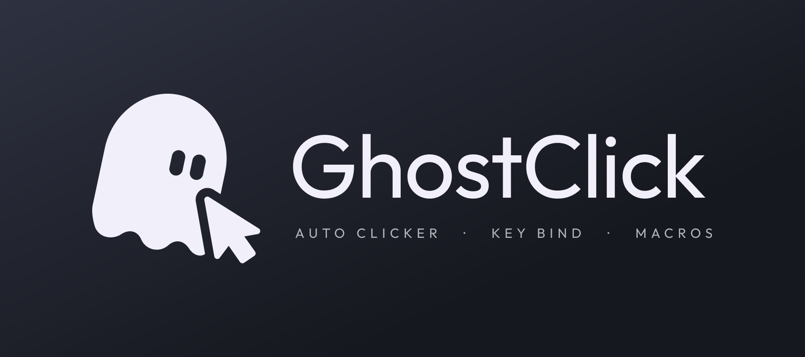
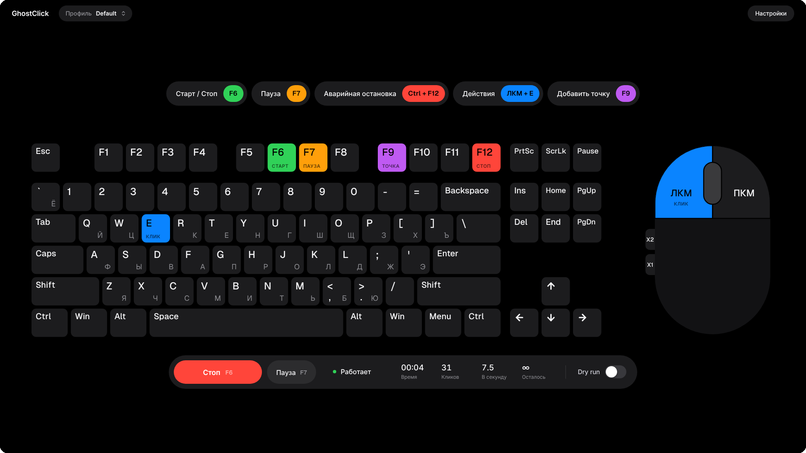

  

  <a href="README.md">English</a> · <b>Русский</b>

  <b>GhostClick нажимает за вас клавиши и кнопки мыши.</b> 
  Выберите, что нажимать, нажмите <b>F6</b> — и он кликает сам: по таймеру на месте курсора
  или по маршруту из точек на экране. Небольшой случайный разброс места и длительности
  нажатий делает их похожими на человеческие.

  
   
  Windows 10 и 11, 64-бит

## Как установить

1. Нажмите **«Скачать для Windows»**. На открывшейся странице, в разделе **Assets**, нажмите
   на файл, имя которого начинается с **GhostClick-Setup** и заканчивается на **.exe**, —
   он скачается. Файлы «Source code» не нужны. Если браузер предупредит, что такой файл
   скачивают редко, выберите «Сохранить» (и подтвердите, если браузер спросит ещё раз).
2. Откройте скачанный файл. Если появится окно «Система Windows защитила ваш компьютер»,
   нажмите **Подробнее** → **Выполнить в любом случае**: так Windows предупреждает о программах
   без цифровой подписи.
3. Нажимайте **Далее**, затем **Установить**. Готово: GhostClick появится в меню «Пуск» и на
   рабочем столе.

Права администратора не нужны. Если в системе не хватает компонента Microsoft Edge WebView2,
установщик поставит его сам.

## Как пользоваться

1. Нажмите **«Действия»** вверху окна, отметьте на нарисованной клавиатуре и мыши, что нажимать,
   и нажмите **«Готово»**. Можно выбрать несколько — они нажимаются одновременно. Сразу после
   установки там уже стоит левая кнопка мыши.
2. Наведите курсор куда нужно и нажмите **F6** — GhostClick начнёт кликать. Снова **F6** — стоп,
   **F7** — пауза, **Ctrl + F12** — аварийная остановка.
3. Чтобы кликать в разных местах, наводите курсор и жмите **F9**: каждая точка добавится в маршрут,
   и GhostClick будет обходить их по очереди.
4. Когда всё настроено, нажмите **«Сохранить»** вверху окна, рядом с названием профиля. Иначе
   после перезапуска GhostClick настройки пропадут.

Горячие клавиши работают, даже когда окно GhostClick не активно, например пока вы в игре.
Любую можно поменять: нажмите на неё вверху окна, а затем нужную клавишу.
Всё остальное — по кнопке **«Настройки»** в правом верхнем углу.

  

## Что умеет

- **Мышь и клавиатура:** левая, правая, средняя и боковые кнопки мыши, клавиши и сочетания
  с Ctrl, Shift, Alt и Win — по одной или несколько сразу.
- **Одиночный или двойной клик**, интервал в миллисекундах, бесконечно или заданное число раз.
- **Два режима:** клавиша включает и выключает кликер или он кликает, пока вы её держите.
- **Маршрут из точек:** курсор переходит от точки к точке мгновенно или плавно.
- **Как человек:** случайный интервал, небольшой разброс точки клика, разная длительность нажатия.
- **Безопасность:** аварийная остановка, стоп, если вы взялись за мышь, клики только в нужное окно.
- **Профили** под разные игры и задачи; последний открывается сам при запуске.

## Полезно знать

- **Обновление:** скачайте новую версию и установите поверх старой — профили сохранятся.
- **Удаление:** Параметры → Приложения → GhostClick → Удалить. Профили останутся, если вы
  сами не выберете их удалить.
- Если игра запущена от имени администратора, GhostClick тоже нужно запустить от имени
  администратора, иначе Windows не пропустит его нажатия.
- В играх с серьёзным античитом (BattlEye, Easy Anti-Cheat, Vanguard и подобных) автокликер,
  скорее всего, заметят.

---

Для разработчиков: устройство программы, сборка и тесты — в [docs/DEVELOPMENT.md](docs/DEVELOPMENT.md).
